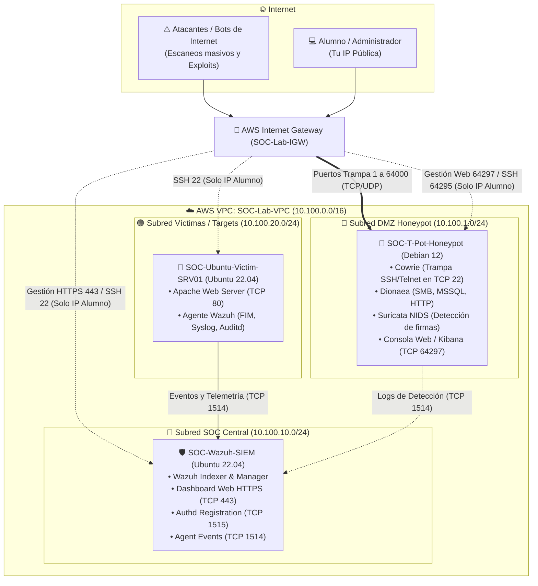

# 🛡️ Guía Oficial: Laboratorio SOC & Honeypot en AWS (Despliegue Manual)

[](https://aws.amazon.com/)
[](https://wazuh.com/)
[](https://github.com/telekom-security/tpotce)
[](https://opensource.org/licenses/MIT)

Guía completa y detallada diseñada para **estudiantes y profesionales de ciberseguridad**. Aprenderás a construir desde cero en la nube de Amazon Web Services (AWS) una infraestructura completa de detección y engaño (**Deception Technologies**), compuesta por:

1. **Honeypot Multi-Sensor (T-Pot Community Edition):** Señuelos activos expuestos a atacantes reales de Internet (Cowrie, Dionaea, Honeytrap, Suricata NIDS).
2. **SIEM Centralizado (Wazuh All-in-One):** Plataforma de monitoreo, correlación de logs y detección de amenazas en tiempo real.
3. **Servidor Víctima Monitoreado (Ubuntu Server):** Host con Apache HTTP supervisado por un agente Wazuh para simular ataques y evaluar alertas mapeadas a **MITRE ATT&CK**.

> [!NOTE]
> Este laboratorio es **100% manual**: no requiere conocimientos de Terraform ni herramientas de automatización IaC.

---

## 🗺️ Arquitectura de Red y Topología



---

## 📋 Requisitos Previos

1. **Cuenta en AWS:** Permisos para crear VPC, Internet Gateway, Subredes, Security Groups e instancias EC2.
2. **Cliente SSH:** Terminal en Linux/macOS, o PowerShell / Git Bash en Windows.
3. **Conocer tu IP Pública:** Consúltala en [https://ifconfig.me](https://ifconfig.me) o ejecutando:
   ```bash
   curl -s ifconfig.me
   ```

---

## FASE 1: Preparación Inicial en la Consola de AWS

### 1.1 Seleccionar la Región
1. Inicia sesión en la [Consola de AWS](https://console.aws.amazon.com/).
2. En la esquina superior derecha, selecciona la región **N. Virginia (`us-east-1`)**.

### 1.2 Crear el Par de Llaves SSH (Key Pair)
1. En el buscador superior, escribe **EC2** y entra al servicio.
2. En el menú lateral izquierdo, ve a **Network & Security** > **Key Pairs**.
3. Haz clic en **Create key pair**:
   * **Name:** `soc-lab-key`
   * **Key pair type:** `RSA`
   * **Private key file format:**
     * Selecciona `.pem` (recomendado para Linux, macOS y Windows PowerShell).
     * Selecciona `.ppk` si vas a utilizar PuTTY.
4. Haz clic en **Create key pair**.
5. Guarda el archivo descargado (`soc-lab-key.pem`) en una carpeta accesible (ej: `~/.ssh/` o `C:\Users\<tu_usuario>\.ssh\`).

---

## FASE 2: Creación de la Red Virtual (VPC)

### 2.1 Crear la VPC
1. En el buscador de servicios, ve a **VPC**.
2. Haz clic en **Create VPC**.
3. Selecciona la opción **VPC only**:
   * **Name tag:** `SOC-Lab-VPC`
   * **IPv4 CIDR block:** `10.100.0.0/16`
4. Haz clic en **Create VPC**.
5. Con la VPC creada seleccionada, ve a **Actions** > **Edit VPC settings** > marca la casilla **Enable DNS hostnames** > **Save changes**.

### 2.2 Crear y Asociar el Internet Gateway
1. En el menú izquierdo de VPC, haz clic en **Internet Gateways**.
2. Haz clic en **Create internet gateway**:
   * **Name tag:** `SOC-Lab-IGW`
3. Haz clic en **Create internet gateway**.
4. Haz clic en el botón superior **Actions** > **Attach to VPC**, selecciona `SOC-Lab-VPC` y presiona **Attach internet gateway**.

### 2.3 Crear las 3 Subredes Públicas
En el menú izquierdo, ve a **Subnets** y haz clic en **Create subnet**. Selecciona `SOC-Lab-VPC` y crea una a una las siguientes subredes:

| Subred | Nombre de la Subred | Zona de Disponibilidad | Bloque CIDR IPv4 |
| :--- | :--- | :--- | :--- |
| **1. DMZ (Honeypot)** | `SOC-DMZ-Honeypots` | `us-east-1a` | `10.100.1.0/24` |
| **2. SOC (SIEM)** | `SOC-Subnet-Management` | `us-east-1a` | `10.100.10.0/24` |
| **3. Víctimas (Targets)** | `SOC-Lab-Monitored-Servers` | `us-east-1a` | `10.100.20.0/24` |

> [!TIP]
> **Habilitar asignación de IP Pública automática:**  
> Selecciona cada subred por separado > **Actions** > **Edit subnet settings** > marca **Enable auto-assign public IPv4 address** > **Save**.

### 2.4 Configurar la Tabla de Ruteo
1. En el menú izquierdo, ve a **Route Tables**.
2. Selecciona la tabla de ruteo asociada a `SOC-Lab-VPC` y nómbrala `SOC-Public-RouteTable`.
3. En la pestaña inferior **Routes** > haz clic en **Edit routes**:
   * Haz clic en **Add route**.
   * **Destination:** `0.0.0.0/0`
   * **Target:** Selecciona **Internet Gateway** y elige `SOC-Lab-IGW`.
   * Haz clic en **Save changes**.
4. En la pestaña **Subnet associations** > haz clic en **Edit subnet associations**:
   * Marca las **3 subredes creadas** (`SOC-DMZ-Honeypots`, `SOC-Subnet-Management`, `SOC-Lab-Monitored-Servers`).
   * Haz clic en **Save associations**.

---

## FASE 3: Configuración de Firewalls (Security Groups)

Ve a **EC2** > **Security Groups** y haz clic en **Create security group** para crear 3 grupos:

### 1. Security Group: SIEM Wazuh (`wazuh-siem-sg`)
* **Name:** `wazuh-siem-sg` | **VPC:** `SOC-Lab-VPC`
* **Inbound rules (Reglas de Entrada):**
  * **HTTPS (443):** Source = `My IP` (Acceso al Dashboard Web).
  * **SSH (22):** Source = `My IP` (Administración del servidor).
  * **Custom TCP (1514):** Source = `10.100.0.0/16` (Recepción de eventos de agentes).
  * **Custom TCP (1515):** Source = `10.100.0.0/16` (Registro de nuevos agentes).

---

### 2. Security Group: Honeypot T-Pot (`honeypot-dmz-sg`)
* **Name:** `honeypot-dmz-sg` | **VPC:** `SOC-Lab-VPC`
* **Inbound rules (Reglas de Entrada):**
  * **Custom TCP (64297):** Source = `My IP` (Web / Kibana de T-Pot).
  * **Custom TCP (64295):** Source = `My IP` (SSH real administrativo post-instalación).
  * **SSH (22):** Source = `My IP` (SSH inicial durante instalación).
  * **All TCP (1 - 64000):** Source = `Anywhere-IPv4` (`0.0.0.0/0`) (Señuelos abiertos).
  * **All UDP (1 - 64000):** Source = `Anywhere-IPv4` (`0.0.0.0/0`) (Señuelos abiertos).

---

### 3. Security Group: Servidor Víctima (`soc-targets-sg`)
* **Name:** `soc-targets-sg` | **VPC:** `SOC-Lab-VPC`
* **Inbound rules (Reglas de Entrada):**
  * **SSH (22):** Source = `My IP` (Administración).
  * **HTTP (80):** Source = `My IP` y `10.100.0.0/16` (Servicio Web de prueba).
  * **All ICMP - IPv4:** Source = `My IP` y `10.100.0.0/16` (Pruebas de Ping).

---

## FASE 4: Lanzamiento de Instancias EC2

Ve a **EC2** > **Instances** > **Launch instances** para desplegar las 3 máquinas:

---

### Instancia 1: Honeypot Multi-Sensor T-Pot
1. **Name:** `SOC-T-Pot-Honeypot`
2. **AMI:**
   * Haz clic en **Browse more AMIs** > pestaña **Community AMIs**.
   * Busca: `debian-12-amd64` y selecciona una imagen oficial de **Debian 12 (Bookworm)**.
3. **Instance type:** `m7i-flex.large` (o `t3.large` con 8 GB de RAM).
4. **Key pair:** `soc-lab-key`.
5. **Network settings (Edit):**
   * **VPC:** `SOC-Lab-VPC`
   * **Subnet:** `SOC-DMZ-Honeypots`
   * **Auto-assign public IP:** `Enable`
   * **Security group:** Selecciona `honeypot-dmz-sg`.
6. **Configure storage:**
   * Cambia el disco a **`100 GiB`** tipo **gp3**.
7. Haz clic en **Launch instance**.

---

### Instancia 2: Wazuh SIEM Central
1. **Name:** `SOC-Wazuh-SIEM`
2. **AMI:** **Ubuntu Server 22.04 LTS (HVM)** x86_64.
3. **Instance type:** `m7i-flex.large` (o `t3.large` con 8 GB de RAM).
4. **Key pair:** `soc-lab-key`.
5. **Network settings (Edit):**
   * **VPC:** `SOC-Lab-VPC`
   * **Subnet:** `SOC-Subnet-Management`
   * **Auto-assign public IP:** `Enable`
   * **Security group:** Selecciona `wazuh-siem-sg`.
6. **Configure storage:**
   * Cambia el disco a **`50 GiB`** tipo **gp3**.
7. Haz clic en **Launch instance**.

---

### Instancia 3: Servidor Víctima Monitoreado
1. **Name:** `SOC-Ubuntu-Victim-SRV01`
2. **AMI:** **Ubuntu Server 22.04 LTS (HVM)** x86_64.
3. **Instance type:** `t3.small` (o `t3.micro`).
4. **Key pair:** `soc-lab-key`.
5. **Network settings (Edit):**
   * **VPC:** `SOC-Lab-VPC`
   * **Subnet:** `SOC-Lab-Monitored-Servers`
   * **Auto-assign public IP:** `Enable`
   * **Security group:** Selecciona `soc-targets-sg`.
6. **Configure storage:** **`20 GiB`** tipo **gp3**.
7. Haz clic en **Launch instance**.

> [!TIP]
> **Etiquetado para gestión de costos:**  
> A las 3 instancias agrégales la etiqueta:  
> **Key:** `Environment` | **Value:** `Cybersecurity-Lab`  
> Esto permitirá encenderlas y apagarlas con un solo comando mediante los scripts incluidos.

---

## FASE 5: Instalación y Configuración por Terminal SSH

Anota en un bloc de notas las **IPs Públicas** y **Privadas** de tus instancias desde la consola de EC2.

---

### 1. Instalación de Wazuh SIEM
Conéctate por SSH a la máquina **`SOC-Wazuh-SIEM`**:
```bash
ssh -i soc-lab-key.pem ubuntu@<IP_PUBLICA_WAZUH>
```

Ejecuta el instalador automático All-in-One:
```bash
# 1. Actualizar sistema y herramientas
sudo apt-get update && sudo apt-get install -y curl tar apt-transport-https

# 2. Descargar instalador y configuración de Wazuh 4.9
curl -sO https://packages.wazuh.com/4.9/wazuh-install.sh
curl -sO https://packages.wazuh.com/4.9/config.yml

# 3. Iniciar instalación desatendida (~8 a 10 minutos)
sudo bash ./wazuh-install.sh -a -i
```

Al terminar, el script imprimirá en pantalla las credenciales:
* **Usuario:** `admin`
* **Contraseña:** *(Copia y guarda la contraseña mostrada)*.
* *(Si la pierdes, consúltala con: `sudo tar -axf wazuh-install-files.tar wazuh-install-files/wazuh-passwords.txt -O`)*.

Abre en tu navegador: **`https://<IP_PUBLICA_WAZUH>`** y accede con tus credenciales.

---

### 2. Instalación de T-Pot Community Edition
Conéctate por SSH a la máquina **`SOC-T-Pot-Honeypot`** (en Debian el usuario por defecto es `admin`):
```bash
ssh -i soc-lab-key.pem admin@<IP_PUBLICA_HONEYPOT>
```

#### Paso A: Crear Memoria SWAP de 8 GB (Obligatorio)
```bash
sudo fallocate -l 8G /swapfile
sudo chmod 600 /swapfile
sudo mkswap /swapfile
sudo swapon /swapfile
echo '/swapfile none swap sw 0 0' | sudo tee -a /etc/fstab
sudo sysctl vm.swappiness=20
```

#### Paso B: Descargar T-Pot y fijar versión estable
```bash
sudo apt-get update && sudo apt-get install -y git curl sudo ca-certificates procps
sudo mkdir -p /opt/tpot
sudo git clone https://github.com/telekom-security/tpotce.git /opt/tpot
cd /opt/tpot

# Checkout de la versión estable para Debian 12:
sudo git checkout 24.04.1
```

#### Paso C: Lanzar el instalador
```bash
sudo ./install.sh
```
1. Tipo de instalación: Selecciona **`STANDARD`**.
2. Web User: Elige un usuario (ej: `admin`).
3. Web Password: Escribe tu contraseña y confírmala.
4. Al terminar la descarga, pulsa **`y`** para reiniciar la máquina.

> [!WARNING]
> **Cambio de Puerto SSH:**  
> A partir del reinicio, el puerto 22 es la trampa *Cowrie*. Para conectarte al SSH real del sistema debes usar el puerto **`64295`**:
> ```bash
> ssh -i soc-lab-key.pem -p 64295 admin@<IP_PUBLICA_HONEYPOT>
> ```

Abre en tu navegador la consola web del Honeypot:  
👉 **`https://<IP_PUBLICA_HONEYPOT>:64297`**

---

### 3. Configuración del Servidor Víctima e Instalación del Agente Wazuh
Conéctate por SSH a **`SOC-Ubuntu-Victim-SRV01`**:
```bash
ssh -i soc-lab-key.pem ubuntu@<IP_PUBLICA_VICTIMA>
```

Ejecuta:
```bash
# 1. Instalar servidor Apache
sudo apt-get update && sudo apt-get install -y curl gnupg apache2

# 2. Configurar repositorio de Wazuh
curl -s https://packages.wazuh.com/key/GPG-KEY-WAZUH | gpg --dearmor | sudo tee /usr/share/keyrings/wazuh.gpg > /dev/null
echo 'deb [signed-by=/usr/share/keyrings/wazuh.gpg] https://packages.wazuh.com/4.x/apt/ stable main' | sudo tee /etc/apt/sources.list.d/wazuh.list
sudo apt-get update

# 3. Instalar el agente apuntando a la IP PRIVADA de tu Wazuh SIEM
# Reemplaza <IP_PRIVADA_WAZUH> por la IP privada (ej: 10.100.10.x)
sudo WAZUH_MANAGER='<IP_PRIVADA_WAZUH>' WAZUH_AGENT_NAME='Ubuntu-Victim-SRV01' apt-get install -y wazuh-agent=4.9.2-1

# 4. Iniciar servicios
sudo systemctl daemon-reload
sudo systemctl enable --now wazuh-agent
sudo systemctl enable --now apache2
```

---

## FASE 6: Validación y Simulación de Ataques

### Actividad 1: Observar Ataques Reales en el Honeypot
1. Entra al portal Web de T-Pot (`https://<IP_PUBLICA_HONEYPOT>:64297`).
2. Haz clic en **Kibana** y abre el dashboard **T-Pot**.
3. Deja pasar 30-60 minutos y analiza:
   * **Attack Map:** Origen geográfico de los atacantes.
   * **Cowrie Dashboard:** Credenciales intentadas contra el puerto SSH 22.
   * **Dionaea:** Intentos de conexión a puertos SMB/MSSQL.

---

### Actividad 2: Simulación de Ataques contra la Víctima (MITRE ATT&CK)
En el servidor víctima, descarga y ejecuta el script de simulación incluido en este repositorio:

```bash
# Opción directa manual en el servidor víctima:
# 1. Inyección SQL (T1190)
curl "http://localhost/?id=1'%20UNION%20SELECT%20null,version()--"

# 2. Alteración sospechosa en archivos del sistema (FIM - T1565)
sudo touch /etc/cron.d/malicious_cron_job

# 3. Fuerza bruta SSH desde otra terminal (T1110)
for i in {1..8}; do ssh fake_user@<IP_PUBLICA_VICTIMA>; done
```

Ve a tu **Wazuh Dashboard > Security Events** y verifica las alertas activadas con sus clasificaciones MITRE ATT&CK.

---

## FASE 7: Ahorro de Créditos de AWS (Apagar y Encender)

Para no consumir créditos cuando no estés practicando:

### Vía Consola de AWS:
1. Ve a **EC2** > **Instances**.
2. Selecciona las 3 máquinas > **Instance state** > **Stop instance**.
3. Para reanudarlas en la próxima clase, selecciona las máquinas > **Start instance**. *(Recuerda que AWS asignará nuevas IPs públicas al encenderlas)*.

### Vía Scripts de Automatización:
En tu computadora local, dentro de la carpeta `scripts/` de este repositorio:
```bash
# Ver estado:
python scripts/manage_lab.py status

# Apagar todo:
python scripts/manage_lab.py stop

# Encender todo:
python scripts/manage_lab.py start
```

---

## 🛠️ Preguntas Frecuentes y Resolución de Problemas

| Error / Síntoma | Causa | Solución |
| :--- | :--- | :--- |
| **`Connection refused` en SSH al Honeypot** | T-Pot movió el SSH real al puerto `64295`. | Conéctate con `ssh -p 64295 admin@<IP>`. |
| **Kibana se cuelga o no carga (`ERR_CONNECTION_REFUSED`)** | Falta de memoria Swap. | Crea el archivo Swap de 8 GB (Fase 5, Paso A). |
| **`T-Pot supports Debian 13, this system runs 12`** | Rama git desactualizada. | Ejecuta `git checkout 24.04.1` antes de `./install.sh`. |
| **El Agente Wazuh aparece desconectado** | IP privada incorrecta o puerto 1514 bloqueado. | Revisa que en `wazuh-agent` hayas configurado la IP privada del SIEM (`10.100.10.x`) y no la pública. |

---

## 👤 Autor & Licencia

* **Autor:** [d-arroyo1974](https://github.com/d-arroyo1974)
* **Licencia:** Distribuido bajo la Licencia MIT. Consulta `LICENSE` para más detalles.
