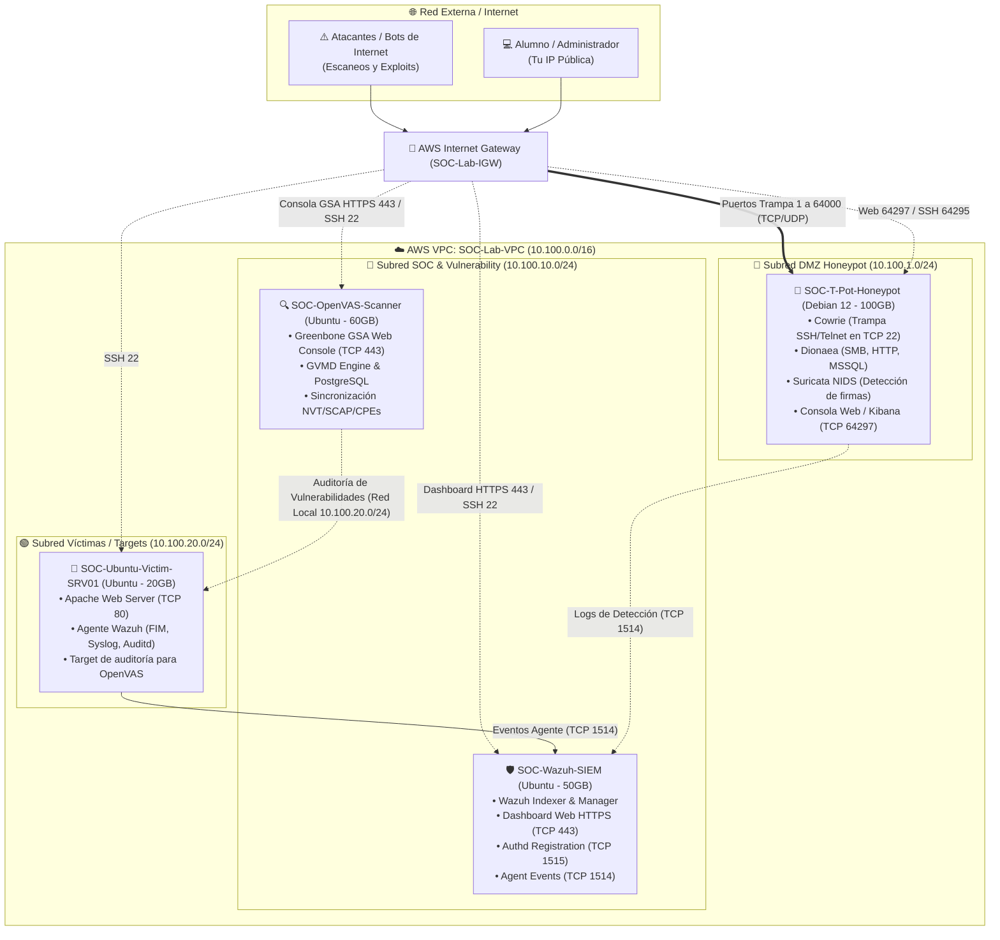

# 🛡️ Guía Oficial: Laboratorio SOC, Honeypot & Vulnerability Management en AWS

[](https://aws.amazon.com/)
[](https://wazuh.com/)
[](https://www.greenbone.net/)
[](https://github.com/telekom-security/tpotce)
[](https://opensource.org/licenses/MIT)

Guía paso a paso diseñada para **estudiantes y profesionales de ciberseguridad**. Construirás de forma **100% manual** (mediante la consola web de AWS y terminal SSH) un laboratorio integral de ciberdefensa en la nube, compuesto por 4 servidores:

1. **🍯 Honeypot Multi-Sensor (T-Pot Community Edition):** Más de 20 señuelos trampa (Cowrie, Dionaea, Honeytrap, Suricata NIDS) abiertos a Internet para capturar malware y atacantes reales.
2. **🛡️ SIEM Central (Wazuh All-in-One):** Plataforma centralizada de monitoreo, correlación de logs, detección de intrusiones y cumplimiento MITRE ATT&CK.
3. **🔍 Escáner de Vulnerabilidades (OpenVAS / Greenbone Community):** Motor de auditoría y análisis de vulnerabilidades (CVEs, SCAP, CPEs) para auditar la red interna.
4. **🐧 Servidor Víctima Monitoreado (Ubuntu 22.04 LTS):** Host con Apache HTTP supervisado por el agente de Wazuh para simulación de ataques y auditorías de vulnerabilidades.

---

## 📊 Matriz de Dimensionamiento (Sizing) y Lecciones Aprendidas

Esta matriz está calculada en base a **lecciones reales aprendidas en despliegues previos**. Ignorar estos tamaños provocará caídas por falta de espacio en disco o agotamiento de memoria RAM:

| Servidor / Instancia | AMI / Sistema | Tipo de Instancia (vCPU / RAM) | Disco EBS (gp3) | Memoria Swap | ⚠️ Lección Aprendida y Causa Raíz |
| :--- | :--- | :--- | :--- | :--- | :--- |
| **🛡️ SOC-Wazuh-SIEM** | Ubuntu 22.04 LTS | `m7i-flex.large` *(2 vCPU, 8 GB RAM)* | **50 GB** | Opcional | **Nunca usar 30 GB:** Al descargar los diccionarios del *Vulnerability Detector* y los índices de Elasticsearch, el disco de 30 GB se satura al 100%, bloqueando la base de datos de alertas. Con 50 GB opera de forma holgada. |
| **🔍 SOC-OpenVAS-Scanner** | Ubuntu 22.04 LTS | `m7i-flex.large` *(2 vCPU, 8 GB RAM)* | **60 GB** | **4 GB** | **Nunca usar 40 GB:** La sincronización de los feeds de NIST (NVT, SCAP y CPEs) en PostgreSQL consume más de 15 GB adicionales. Con 40 GB arroja `ERROR: could not extend file: No space left on device`. Se requieren mínimo 60 GB + 4 GB Swap. |
| **🍯 SOC-T-Pot-Honeypot** | Debian 12 Bookworm | `m7i-flex.large` *(2 vCPU, 8 GB RAM)* | **100 GB** | **8 GB** | **Swap de 8 GB Obligatorio:** T-Pot levanta más de 20 contenedores Docker. Sin Swap, el sistema entra en pánico de memoria RAM (OOM) y Kibana se congela arrojando `ERR_CONNECTION_REFUSED`. |
| **🐧 SOC-Ubuntu-Victim-SRV01** | Ubuntu 22.04 LTS | `t3.small` *(1-2 vCPU, 2 GB RAM)* | **20 GB** | No requerida | Servidor liviano para Apache y el agente Wazuh. No requiere alto cómputo. |

> [!IMPORTANT]
> **¿Por qué usamos `m7i-flex.large` en lugar de `t3.large`?**  
> Muchas cuentas de AWS devuelven el error `InvalidParameterCombination: The specified instance type is not eligible for Free Tier` al solicitar `t3.large`. La familia de última generación **`m7i-flex.large`** (Intel Sapphire Rapids x86_64) no tiene este bloqueo, ofrece un rendimiento de CPU superior y garantiza que tanto Wazuh, OpenVAS como T-Pot funcionen con fluidez.

---

## 🗺️ Arquitectura de Red y Topología



---

## 📋 Requisitos Previos

1. **Cuenta activa en AWS** con permisos para gestionar VPCs, Security Groups e instancias EC2.
2. **Cliente SSH** (Terminal en macOS/Linux, o PowerShell en Windows).
3. **Conocer tu IP Pública:** Consúltala en [https://ifconfig.me](https://ifconfig.me) o ejecutando:
   ```bash
   curl -s ifconfig.me
   ```

---

## FASE 1: Preparación en AWS (Región y Llaves SSH)

### 1.1 Región
En la consola de AWS, selecciona arriba a la derecha la región **N. Virginia (`us-east-1`)**.

### 1.2 Crear el Par de Llaves SSH (Key Pair)
1. Ve a **EC2** > **Key Pairs** > **Create key pair**.
2. **Name:** `soc-lab-key` | **Key pair type:** `RSA` | **Private key format:** `.pem`.
3. Haz clic en **Create key pair** y guarda el archivo `soc-lab-key.pem` en tu equipo.

---

## FASE 2: Creación de la Red Virtual (VPC y Subredes)

### 2.1 Crear la VPC
1. Ve a **VPC** > **Create VPC** > opción **VPC only**:
   * **Name tag:** `SOC-Lab-VPC`
   * **IPv4 CIDR block:** `10.100.0.0/16`
2. Clic en **Create VPC**.
3. Selecciona la VPC creada > **Actions** > **Edit VPC settings** > marca **Enable DNS hostnames** > **Save**.

### 2.2 Crear el Internet Gateway
1. En **Internet Gateways** > **Create internet gateway**:
   * **Name tag:** `SOC-Lab-IGW`
2. Clic en **Create internet gateway**.
3. En **Actions** > **Attach to VPC** > selecciona `SOC-Lab-VPC` > **Attach internet gateway**.

### 2.3 Crear las 3 Subredes Públicas
En **Subnets** > **Create subnet**, selecciona `SOC-Lab-VPC` y crea:

| Subred | Nombre de Subred | Zona | CIDR IPv4 |
| :--- | :--- | :--- | :--- |
| **1. DMZ (Honeypot)** | `SOC-DMZ-Honeypots` | `us-east-1a` | `10.100.1.0/24` |
| **2. SOC & Scanner** | `SOC-Subnet-Management` | `us-east-1a` | `10.100.10.0/24` |
| **3. Víctimas (Targets)** | `SOC-Lab-Monitored-Servers` | `us-east-1a` | `10.100.20.0/24` |

> [!TIP]
> **Activar IP Pública automática:** Selecciona cada subred > **Actions** > **Edit subnet settings** > marca **Enable auto-assign public IPv4 address** > **Save**.

### 2.4 Configurar la Tabla de Ruteo
1. En **Route Tables**, selecciona la tabla de `SOC-Lab-VPC` y nómbrala `SOC-Public-RouteTable`.
2. En la pestaña **Routes** > **Edit routes** > **Add route**:
   * **Destination:** `0.0.0.0/0` | **Target:** Internet Gateway (`SOC-Lab-IGW`) > **Save changes**.
3. En la pestaña **Subnet associations** > **Edit subnet associations**:
   * Marca las **3 subredes** > **Save associations**.

---

## FASE 3: Configuración de Grupos de Seguridad (Security Groups)

Ve a **EC2** > **Security Groups** y crea los 4 grupos:

### 1. Security Group: SIEM Wazuh (`wazuh-siem-sg`)
* **VPC:** `SOC-Lab-VPC`
* **Reglas de Entrada (Inbound):**
  * **HTTPS (443):** Source = `My IP` (Dashboard Web).
  * **SSH (22):** Source = `My IP` (Terminal SSH).
  * **Custom TCP (1514):** Source = `10.100.0.0/16` (Logs de agentes Wazuh).
  * **Custom TCP (1515):** Source = `10.100.0.0/16` (Registro authd de agentes).

---

### 2. Security Group: Escáner OpenVAS (`soc-openvas-sg`)
* **VPC:** `SOC-Lab-VPC`
* **Reglas de Entrada (Inbound):**
  * **HTTPS (443):** Source = `My IP` (Consola Web Greenbone GSA).
  * **Custom TCP (9392):** Source = `My IP` (Redirección HTTP de GSA).
  * **SSH (22):** Source = `My IP` (Terminal SSH).

---

### 3. Security Group: Honeypot T-Pot (`honeypot-dmz-sg`)
* **VPC:** `SOC-Lab-VPC`
* **Reglas de Entrada (Inbound):**
  * **Custom TCP (64297):** Source = `My IP` (Web / Kibana).
  * **Custom TCP (64295):** Source = `My IP` (SSH real de gestión).
  * **SSH (22):** Source = `My IP` (SSH inicial para instalación).
  * **All TCP (1 - 64000):** Source = `Anywhere-IPv4` (`0.0.0.0/0`) (Trampas señuelos).
  * **All UDP (1 - 64000):** Source = `Anywhere-IPv4` (`0.0.0.0/0`) (Trampas señuelos).

---

### 4. Security Group: Servidor Víctima (`soc-targets-sg`)
* **VPC:** `SOC-Lab-VPC`
* **Reglas de Entrada (Inbound):**
  * **SSH (22):** Source = `My IP` (Terminal SSH).
  * **HTTP (80):** Source = `My IP` y `10.100.0.0/16` (Servicio web Apache).
  * **All ICMP - IPv4:** Source = `My IP` y `10.100.0.0/16` (Ping).
  * **All Traffic:** Source = `soc-openvas-sg` (Permite que OpenVAS audite todos los puertos).

---

## FASE 4: Lanzamiento de las 4 Instancias EC2

Ve a **EC2** > **Instances** > **Launch instances**:

### 1. `SOC-T-Pot-Honeypot`
* **AMI:** Community AMIs > `debian-12-amd64` (Debian 12 Bookworm).
* **Tipo:** `m7i-flex.large` (2 vCPU, 8 GB RAM).
* **Key pair:** `soc-lab-key`.
* **Red:** Subred `SOC-DMZ-Honeypots` | Security Group `honeypot-dmz-sg`.
* **Disco:** **`100 GiB`** gp3.

### 2. `SOC-Wazuh-SIEM`
* **AMI:** Ubuntu Server 22.04 LTS.
* **Tipo:** `m7i-flex.large` (2 vCPU, 8 GB RAM).
* **Key pair:** `soc-lab-key`.
* **Red:** Subred `SOC-Subnet-Management` | Security Group `wazuh-siem-sg`.
* **Disco:** **`50 GiB`** gp3 *(¡Nunca 30 GB!)*.

### 3. `SOC-OpenVAS-Scanner`
* **AMI:** Ubuntu Server 22.04 LTS.
* **Tipo:** `m7i-flex.large` (2 vCPU, 8 GB RAM).
* **Key pair:** `soc-lab-key`.
* **Red:** Subred `SOC-Subnet-Management` | Security Group `soc-openvas-sg`.
* **Disco:** **`60 GiB`** gp3 *(¡Nunca 40 GB!)*.

### 4. `SOC-Ubuntu-Victim-SRV01`
* **AMI:** Ubuntu Server 22.04 LTS.
* **Tipo:** `t3.small` (o `t3.micro`).
* **Key pair:** `soc-lab-key`.
* **Red:** Subred `SOC-Lab-Monitored-Servers` | Security Group `soc-targets-sg`.
* **Disco:** **`20 GiB`** gp3.

> [!TIP]
> **Etiqueta en las 4 instancias:**  
> **Key:** `Environment` | **Value:** `Cybersecurity-Lab` (para control con scripts).

---

## FASE 5: Instalación y Configuración por Terminal SSH

---

### 1. Instalación de Wazuh SIEM
Conéctate por SSH a `SOC-Wazuh-SIEM`:
```bash
ssh -i soc-lab-key.pem ubuntu@<IP_PUBLICA_WAZUH>
```
Ejecuta:
```bash
sudo apt-get update && sudo apt-get install -y curl tar apt-transport-https
curl -sO https://packages.wazuh.com/4.9/wazuh-install.sh
curl -sO https://packages.wazuh.com/4.9/config.yml
sudo bash ./wazuh-install.sh -a -i
```
Al finalizar, guarda la contraseña del usuario `admin` mostrada en pantalla. Accede desde tu navegador a `https://<IP_PUBLICA_WAZUH>`.

---

### 2. Instalación de OpenVAS / Greenbone Community
Conéctate por SSH a `SOC-OpenVAS-Scanner`:
```bash
ssh -i soc-lab-key.pem ubuntu@<IP_PUBLICA_OPENVAS>
```
Ejecuta los siguientes comandos (o corre `scripts/setup_openvas.sh`):
```bash
# 1. Swap de 4 GB para la indexación de CVEs
sudo fallocate -l 4G /swapfile
sudo chmod 600 /swapfile
sudo mkswap /swapfile
sudo swapon /swapfile
echo '/swapfile none swap sw 0 0' | sudo tee -a /etc/fstab

# 2. Instalar Docker
sudo apt-get update && sudo apt-get install -y docker.io docker-compose curl sed
sudo systemctl enable --now docker

# 3. Descargar y preparar el stack de Greenbone
sudo mkdir -p /opt/greenbone-community-container
cd /opt/greenbone-community-container
sudo curl -f -L https://greenbone.github.io/docs/latest/_static/compose.yaml -o compose.yaml

# 4. Exponer puertos 443 y 9392
sudo sed -i 's/127.0.0.1:9392:9392/0.0.0.0:9392:9392/g' compose.yaml
sudo sed -i 's/127.0.0.1:443:443/0.0.0.0:443:443/g' compose.yaml

# 5. Iniciar contenedores en segundo plano
sudo docker compose -f compose.yaml -p greenbone-community-edition up -d
```

Espera 3 minutos a que los contenedores arranquen y define la contraseña de `admin`:
```bash
sudo docker exec -u gvmd greenbone-community-edition-gvmd-1 gvmd --user=admin --new-password='TuPasswordSegura'
```
Abre en tu navegador: **`https://<IP_PUBLICA_OPENVAS>`** *(acepta el certificado autofirmado e inicia sesión con `admin`)*.

---

### 3. Instalación de T-Pot Honeypot
Conéctate por SSH a `SOC-T-Pot-Honeypot`:
```bash
ssh -i soc-lab-key.pem admin@<IP_PUBLICA_HONEYPOT>
```
Ejecuta:
```bash
# 1. Swap de 8 GB (¡Obligatorio para evitar caídas de Kibana!)
sudo fallocate -l 8G /swapfile
sudo chmod 600 /swapfile
sudo mkswap /swapfile
sudo swapon /swapfile
echo '/swapfile none swap sw 0 0' | sudo tee -a /etc/fstab
sudo sysctl vm.swappiness=20

# 2. Descargar T-Pot y fijar la versión estable 24.04.1
sudo apt-get update && sudo apt-get install -y git curl sudo ca-certificates procps
sudo mkdir -p /opt/tpot
sudo git clone https://github.com/telekom-security/tpotce.git /opt/tpot
cd /opt/tpot
sudo git checkout 24.04.1

# 3. Lanzar el instalador interactivo
sudo ./install.sh
```
* Selecciona **`STANDARD`**, crea un usuario y contraseña web, y pulsa **`y`** para reiniciar.
* Tras reiniciar, el SSH de administración pasa a ser el puerto **`64295`**:
  ```bash
  ssh -i soc-lab-key.pem -p 64295 admin@<IP_PUBLICA_HONEYPOT>
  ```
* Consola Web: **`https://<IP_PUBLICA_HONEYPOT>:64297`**.

---

### 4. Configuración del Servidor Víctima e Instalación del Agente Wazuh
Conéctate por SSH a `SOC-Ubuntu-Victim-SRV01`:
```bash
ssh -i soc-lab-key.pem ubuntu@<IP_PUBLICA_VICTIMA>
```
Ejecuta:
```bash
# 1. Instalar Apache
sudo apt-get update && sudo apt-get install -y curl gnupg apache2

# 2. Configurar repositorio de Wazuh
curl -s https://packages.wazuh.com/key/GPG-KEY-WAZUH | gpg --dearmor | sudo tee /usr/share/keyrings/wazuh.gpg > /dev/null
echo 'deb [signed-by=/usr/share/keyrings/wazuh.gpg] https://packages.wazuh.com/4.x/apt/ stable main' | sudo tee /etc/apt/sources.list.d/wazuh.list
sudo apt-get update

# 3. Instalar agente apuntando a la IP PRIVADA de Wazuh SIEM (10.100.10.x)
sudo WAZUH_MANAGER='<IP_PRIVADA_WAZUH>' WAZUH_AGENT_NAME='Ubuntu-Victim-SRV01' apt-get install -y wazuh-agent=4.9.2-1

# 4. Iniciar servicios
sudo systemctl daemon-reload
sudo systemctl enable --now wazuh-agent
sudo systemctl enable --now apache2
```

---

## FASE 6: Prácticas de Laboratorio

### Práctica 1: Escaneo de Vulnerabilidades con OpenVAS
1. Entra a la consola de Greenbone (`https://<IP_PUBLICA_OPENVAS>`).
2. Ve a **Configuration** > **Targets** > **New Target**:
   * **Name:** `SOC-Ubuntu-Victim`
   * **Hosts:** Escribe la IP privada del servidor víctima (`10.100.20.x`).
3. Ve a **Scans** > **Tasks** > **New Task**:
   * **Name:** `Escaneo Vulnerabilidades - Servidor Apache`
   * **Scan Targets:** Selecciona `SOC-Ubuntu-Victim`.
   * **Scan Config:** `Full and fast`.
4. Inicia el escaneo y analiza el reporte de vulnerabilidades y CVEs detectados.

---

### Práctica 2: Simulación de Ataques y Detección MITRE ATT&CK en Wazuh
En el servidor víctima (`SOC-Ubuntu-Victim-SRV01`), simula ataques:
```bash
# Inyección SQL simulada (T1190)
curl "http://localhost/?id=1'%20UNION%20SELECT%20null,version()--"

# Modificación de archivos del sistema - FIM (T1565)
sudo touch /etc/cron.d/malicious_job

# Fuerza bruta SSH (T1110)
for i in {1..8}; do ssh fake_user@<IP_PUBLICA_VICTIMA>; done
```
Revisa en **Wazuh Dashboard > Security Events** las alertas activadas en tiempo real.

---

### Práctica 3: Análisis de Atacantes Reales en el Honeypot
1. Entra a **T-Pot Web** (`https://<IP_PUBLICA_HONEYPOT>:64297`) > **Kibana**.
2. Abre el dashboard **T-Pot** y examina el **Attack Map** global, los diccionarios de ataque en **Cowrie** y los escaneos de vulnerabilidades detectados por **Suricata NIDS**.

---

## FASE 7: Ahorro de Créditos (Apagar y Encender)

Las 3 instancias de 8 GB de RAM acumulan costo por hora. Al finalizar cada clase:

```bash
# Apagar todas las instancias (Costo de cómputo = $0.00):
python scripts/manage_lab.py stop

# Encender todas las instancias para la siguiente sesión:
python scripts/manage_lab.py start
```

---

## 👤 Autor & Licencia

* **Autor:** [d-arroyo1974](https://github.com/d-arroyo1974)
* **Licencia:** Distribuido bajo la Licencia MIT. Consulta `LICENSE` para más detalles.
